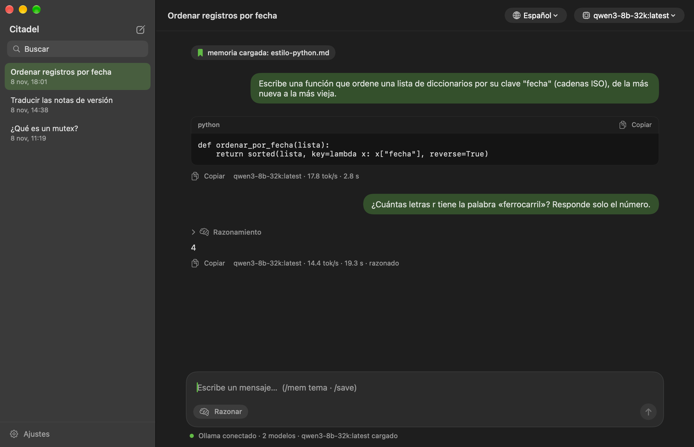
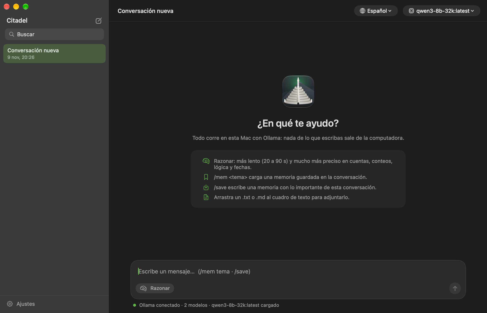
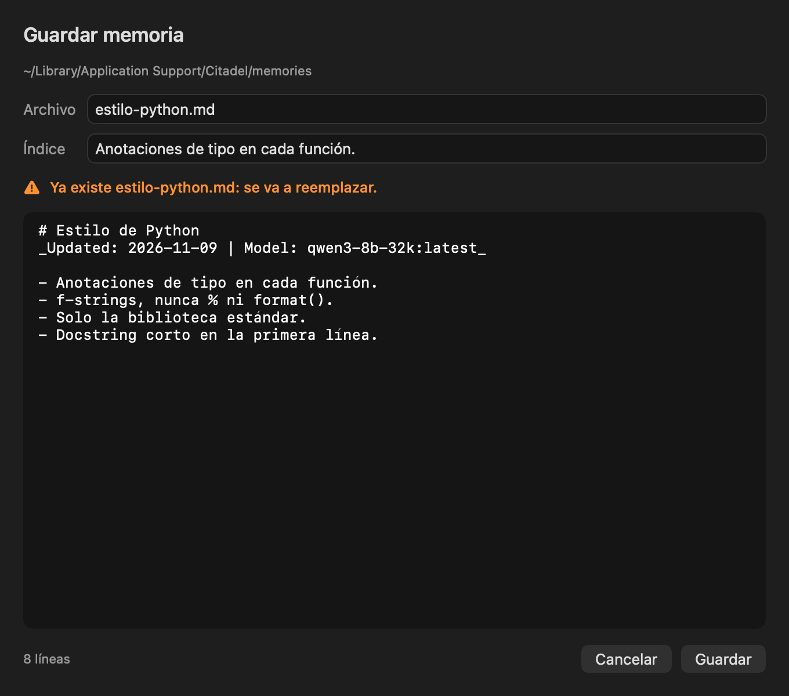
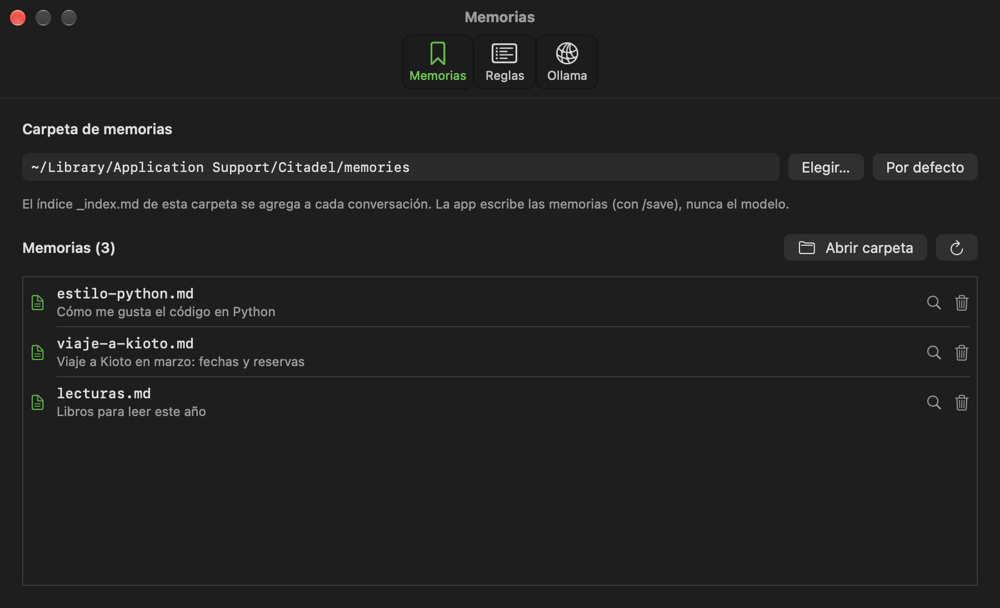
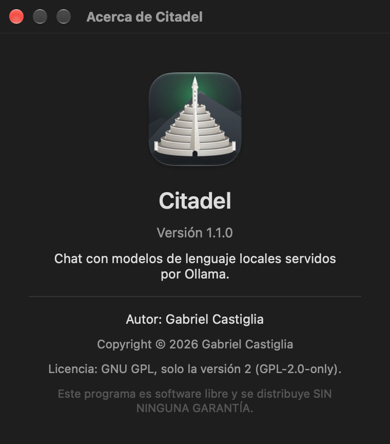

# Citadel

Gabriel Castiglia · 9 de noviembre de 2026 · versión 1.1.0 · licencia GPL-2.0

[English](README.md) · Español

Repositorio: <https://github.com/Gabriel-Castiglia/citadel>

Manual en PDF: [`docs/Citadel-manual-es.pdf`](docs/Citadel-manual-es.pdf)

Citadel es una app de chat para macOS que conversa con modelos de lenguaje que corren en la misma Mac
mediante [Ollama](https://ollama.com). Nada de lo que escribes sale de la computadora: la app solo se
conecta con Ollama en `127.0.0.1:11434`, salvo que elijas usar el Ollama de otra computadora tuya por
SSH (ver [Ollama en otra computadora](#ollama-en-otra-computadora)). Está escrita en Swift y SwiftUI, se compila solo con las
Command Line Tools de Apple (sin Xcode) y su interfaz está en inglés y en español. La versión para
Windows, con las mismas funciones, tiene su propio repositorio:
<https://github.com/Gabriel-Castiglia/citadel-windows>.

Citadel es una ventana de chat, no un agente. El modelo no puede abrir archivos, ejecutar comandos ni
navegar por la web. Recibe lo que escribes, los archivos de texto que adjuntas, unas reglas que van con
cada pedido y, cuando lo pides, una de tus memorias guardadas.



## Requisitos

- macOS 14 Sonoma o posterior, en una Mac con chip de Apple.
- Ollama, funcionando como servicio, con al menos un modelo:

  ```
  brew install ollama
  brew services start ollama
  ollama pull qwen3:8b
  ```

- Para compilar desde el código: las Command Line Tools de Apple (`xcode-select --install`), que traen Swift 6. Para
  generar también los manuales en PDF: pandoc (`brew install pandoc`) y Google Chrome.

Citadel arranca con el modelo `qwen3-8b-32k:latest` elegido si está instalado y, si no, con el primero
que liste Ollama. Ese nombre es Qwen3 8B con un contexto de 32.768 tokens, creado así:

```
printf 'FROM qwen3:8b\nPARAMETER num_ctx 32768\n' > Modelfile
ollama create qwen3-8b-32k -f Modelfile
```

En una Mac con 16 GB de memoria, este modelo ocupa unos 7 GB mientras está cargado y escribe entre 17 y
23 tokens por segundo. Ollama lo carga con el primer mensaje y lo descarga tras 5 minutos sin uso.

## Instalación

### Con el paquete de instalación

Descarga `Citadel-<versión>.pkg` de la
[página de versiones](https://github.com/Gabriel-Castiglia/citadel/releases) y ábrelo. El instalador
está en inglés o en castellano, según el idioma de la Mac; muestra una página de bienvenida y la
licencia, e instala `Citadel.app` en `/Applications`, cerrando antes una copia abierta. Instalar un
paquete más nuevo sobre uno anterior actualiza Citadel; las conversaciones, las reglas, las memorias y
los ajustes se conservan.

El paquete no está firmado con un Developer ID de Apple, así que la primera vez macOS se niega a
abrirlo («Apple no pudo verificar…»). Abre Ajustes del Sistema → Privacidad y seguridad, baja hasta el
aviso sobre `Citadel-<versión>.pkg`, haz clic en Abrir igualmente y confirma. Hace falta una vez por
cada paquete descargado; la app instalada abre sin avisos. El archivo `SHA256SUMS.txt` de cada versión
permite comprobar antes la descarga:

```
shasum -a 256 Citadel-1.1.0.pkg
```

### Desde el código

```
git clone https://github.com/Gabriel-Castiglia/citadel.git
cd citadel
./scripts/instalar.sh
```

`instalar.sh` compila la app, la firma y la copia a `/Applications/Citadel.app`; si hay una copia
abierta, primero la cierra, y después borra la copia que queda en `build/`, así Spotlight muestra
Citadel una sola vez. La primera vez, el paso de firma crea un certificado propio en tu Mac (ver
[Firma](#firma)). Para actualizar después de un `git pull` se corre el mismo comando; las
conversaciones, las reglas, las memorias y los ajustes se conservan. `./scripts/paquete.sh` arma en
cambio el paquete de instalación, en `build/`. Una copia instalada con el paquete pertenece a root,
así que `instalar.sh` se detiene y dice cómo quitarla antes.

### Desinstalar

Arrastra `/Applications/Citadel.app` a la Papelera. Los datos quedan en
`~/Library/Application Support/Citadel` y los ajustes en el dominio de preferencias
`io.github.gabriel-castiglia.citadel`. Para borrarlos también:

```
rm -rf ~/Library/Application\ Support/Citadel
defaults delete io.github.gabriel-castiglia.citadel
security delete-keychain ~/Library/Keychains/citadel-signing.keychain-db
security delete-generic-password -s citadel-local-signing
```

Las dos últimas líneas borran el certificado de firma y la contraseña de su llavero, que solo existen
en una Mac que compiló Citadel desde el código. Sin ellas, una compilación posterior vuelve a usar el
mismo certificado. Si se instaló con el paquete, `sudo pkgutil --forget
io.github.gabriel-castiglia.citadel.pkg` borra además el registro que macOS guarda de la instalación.

## Uso



Escribe en el cuadro de abajo y pulsa Enter para enviar. Shift+Enter (u Option+Enter) empieza una línea
nueva. La respuesta aparece a medida que se escribe, con formato Markdown: títulos, listas, tablas,
citas, negrita, código en línea y bloques de código en un recuadro de letra monoespaciada con su propio
botón Copiar. Debajo de cada respuesta están el botón Copiar de la respuesta entera, el modelo, su
velocidad en tokens por segundo y los segundos que tardó.

### Conversaciones

La barra lateral lista las conversaciones, de la más nueva a la más vieja. ⌘N o el botón del lápiz
empiezan una nueva, cuyo título es la primera línea del primer mensaje. Con clic derecho sobre una
conversación se la renombra o se la elimina; eliminar pide confirmación y borra su archivo del disco. El
campo de búsqueda filtra por título sin distinguir mayúsculas ni tildes.

### Modelos

El menú de modelos, arriba a la derecha, lista todos los modelos instalados en Ollama; eliges uno y el
próximo mensaje va a ese. La elección se recuerda, y debajo de cada respuesta figura el modelo que la
escribió, así que en una misma conversación se pueden comparar varios. «Actualizar lista» vuelve a
leer la lista después de instalar un modelo desde la Terminal:

```
ollama pull gemma3:12b
```

Sirve cualquier modelo de chat de la [biblioteca de Ollama](https://ollama.com/library). Los modelos
que no pueden razonar (Ollama no incluye «thinking» entre sus capacidades) aparecen en el menú con
«(sin Razonar)», y con uno de ellos elegido el botón Razonar queda atenuado y su ayuda dice por qué.
Citadel le pregunta a Ollama las capacidades de cada modelo al listarlos, así que un modelo nuevo
queda clasificado en cuanto aparece.

Ollama le da a cada modelo una ventana de contexto de unos pocos miles de tokens, salvo que el modelo
indique otra. Para conversaciones largas o adjuntos grandes, crea una variante con una ventana mayor,
como en [Requisitos](#requisitos), y elígela en el menú. Una ventana mayor ocupa más memoria.

### Estado

La línea bajo el cuadro de texto dice si Ollama responde y dónde (en esta Mac, o en otra computadora
por SSH), si el modelo está cargado o se cargará con el próximo mensaje, qué está haciendo (cargando,
razonando, escribiendo) con los segundos transcurridos, y la velocidad de la última respuesta. Cuando
Ollama no responde, esa misma línea da el arreglo: `brew services start ollama`, o el error de SSH.

### Razonar

El botón Razonar hace que el modelo piense antes de contestar. Su razonamiento va en un bloque atenuado
sobre la respuesta. El bloque queda plegado, mostrando la última línea mientras el modelo piensa, y se
abre con un clic. Razonar es más lento y mucho más preciso en cuentas, conteos de letras o palabras,
lógica y fechas. Sin razonar, el modelo contesta enseguida y alcanza para explicaciones, redacción,
traducción y código. Razonar solo está disponible con los modelos que saben razonar (ver
[Modelos](#modelos)).

Con Razonar activo, una respuesta puede escribir hasta 8.000 tokens; sin él, hasta 3.000. En
[Notas técnicas](#notas-técnicas) están las mediciones que llevaron a esos valores.

### Detener

Mientras se escribe una respuesta, el botón de enviar pasa a ser Detener (también ⌘.). Cierra la
conexión y Ollama deja de generar; lo escrito hasta ese momento queda, marcado como «Detenido».

### Adjuntos

Arrastra un archivo `.txt` o `.md` al cuadro de texto para adjuntar su texto al próximo mensaje; una
etiqueta muestra el nombre del archivo y su largo, con un botón para quitarlo.

### Memorias

Una memoria es un archivo Markdown breve en la carpeta de memorias, listado en el `_index.md` de esa
carpeta con una línea por memoria:

```
`viaje-a-kioto.md` — Viaje a Kioto en marzo: fechas y reservas
```

El índice va con cada pedido, así el modelo sabe qué memorias existen. Su contenido no va, hasta que
cargas una:

- `/mem <tema>` busca la memoria cuya línea del índice o nombre de archivo comparte más palabras con el
  tema (sin distinguir tildes ni mayúsculas) y la agrega a la conversación. Una etiqueta muestra
  «memoria cargada:» y el nombre del archivo. Si nada coincide, Citadel lo dice.
- `/save` le pide al modelo que escriba una memoria con la conversación actual: un título, la línea
  `_Updated: AAAA-MM-DD | Model: <modelo>_` y los datos que vale la pena guardar, en el idioma de la
  conversación. Se abre una vista previa donde se pueden corregir el nombre del archivo, la línea del
  índice y el texto. Si el archivo ya existe, la vista previa avisa que se va a reemplazar. Guardar
  escribe el archivo y su línea del índice, los vuelve a leer del disco y solo entonces lo confirma en
  la conversación.



Las memorias las escribe Citadel, no el modelo. Los modelos locales chicos suelen contestar «guardado»
sin guardar nada; por eso el modelo solo redacta el texto, y la app escribe el archivo y lo comprueba.

### Ajustes

Citadel → Ajustes… (⌘,) tiene tres pestañas.



| Pestaña | Qué contiene |
|---|---|
| Memorias | La carpeta de memorias (Elegir…, o Por defecto para volver a `~/Library/Application Support/Citadel/memories`), la lista de memorias con su línea del índice, Abrir carpeta, Mostrar en Finder para cada memoria, y Eliminar, que pide confirmación y borra el archivo y su línea del índice. |
| Reglas | Las reglas que van al principio de cada pedido, editables. Guardar (⌘S) las escribe; Descartar cambios deshace lo editado; Restaurar las originales vuelve a las reglas de fábrica. |
| Ollama | Dónde corre Ollama: en esta Mac, o en otra computadora por SSH (ver [Ollama en otra computadora](#ollama-en-otra-computadora)). Aplicar y probar se conecta enseguida y lista los modelos que encuentra. |

Cualquier carpeta puede ser la carpeta de memorias, también una que use otra herramienta, mientras
mantenga el mismo formato de `_index.md`.

### Reglas

Cada pedido empieza con un mensaje de sistema formado por el archivo de reglas, el índice de memorias y
las memorias cargadas con `/mem`. El archivo de reglas es
`~/Library/Application Support/Citadel/rules.md` y se crea en el primer arranque con estas reglas (en
inglés, que es como mejor las siguen los modelos chicos):

1. Contestar en el idioma del usuario y exactamente lo que se pidió; si solo se pide el resultado, dar
   solo el resultado.
2. No inventar: si no sabe la respuesta, si es posterior a sus datos de entrenamiento, si es privada o
   trata de algo que quizá no existe, decirlo en una oración.
3. Revisar la premisa y avisar primero si es falsa.
4. Formatos exactos: solo JSON, solo una lista o exactamente N elementos quiere decir exactamente eso.
5. Código: un bloque de código Markdown cercado con la función completa, sin `input()` ni llamadas de
   ejemplo.
6. Traducción: dejar sin cambios el texto entre comillas invertidas, las rutas, los comandos, los
   números y los nombres, y contestar solo con la traducción.
7. El modelo corre localmente con Ollama y nada sale de la computadora.

La última regla está porque un modelo local, cuando se le pregunta dónde corre, tiende a contestar que
en la nube, cosa que no puede saber.

### Idioma

La interfaz arranca en inglés. El botón del globo, arriba a la derecha junto al menú de modelos,
muestra el idioma actual y cambia entre English y Español; el menú Idioma de la barra de menús
(Language, en inglés) hace lo mismo. El cambio se aplica al instante y se recuerda. Los menús que
macOS agrega a toda app (Edición, Visualización, Ventana, Ayuda) siguen el mismo idioma desde el
próximo arranque, porque macOS lo lee cuando la app se abre. El idioma de la interfaz no cambia el de
las respuestas: el modelo contesta en el idioma en que le escribes.

### Ollama en otra computadora

Un modelo demasiado grande para esta Mac puede correr en otra computadora tuya, y Citadel puede usarlo
por SSH. Citadel abre `/usr/bin/ssh` con un túnel desde un puerto local libre hasta el puerto 11434 de
esa computadora, manda cada pedido por ahí y lo cierra al salir. El puerto de Ollama nunca se abre a
la red: a la otra computadora solo le hace falta aceptar SSH. Las conversaciones, las reglas y las
memorias se quedan en esta Mac; la otra computadora recibe cada pedido cuando se envía, como pasa
siempre con Ollama.

En la computadora que corre el modelo:

1. Instala Ollama y los modelos, como en [Requisitos](#requisitos). A Ollama le basta escuchar en
   `127.0.0.1`, que es lo que hace de fábrica.
2. Enciende el servidor SSH: en una Mac, Ajustes del Sistema → General → Compartir → Sesión remota; en
   Windows, Configuración → Sistema → Características opcionales → Servidor OpenSSH, y después inicia
   el servicio `sshd`.
3. Autoriza la llave pública de esta Mac (`~/.ssh/id_ed25519.pub`; si no existe, créala con
   `ssh-keygen -t ed25519`). En el `~/.ssh/authorized_keys` del usuario, una línea como esta deja que
   esa llave reenvíe el puerto de Ollama y nada más (ni terminal, ni comandos, ni otros puertos):

   ```
   restrict,port-forwarding,permitopen="127.0.0.1:11434",command="/usr/bin/false" ssh-ed25519 AAAA… nombre
   ```

En esta Mac, abre Ajustes → Ollama, elige «En otra computadora, por SSH», escribe el destino
(`usuario@equipo`, o un nombre `Host` de `~/.ssh/config`) y haz clic en Aplicar y probar. La línea de
resultado lista los modelos que hay allá, y la línea de estado bajo el cuadro de texto dice «Ollama en
<equipo> (SSH)». Citadel nunca pide contraseña (corre ssh en modo por lotes), así que la llave tiene
que funcionar sin una o estar cargada en el agente SSH. La primera conexión a un equipo nuevo guarda
su llave en `~/.ssh/known_hosts`; si esa llave cambia después, la conexión falla, como en cualquier
cliente SSH. Si la conexión se corta, Citadel la vuelve a abrir con el pedido siguiente.



### Teclado

| Teclas | Acción |
|---|---|
| Enter | Enviar |
| Shift+Enter, Option+Enter | Línea nueva |
| ⌘N | Conversación nueva |
| ⌘. | Detener la respuesta |
| ⌘, | Ajustes |
| ⌘S | Guardar las reglas (pestaña Reglas) |

## Archivos

| Qué | Dónde |
|---|---|
| App | `/Applications/Citadel.app` |
| Conversaciones | `~/Library/Application Support/Citadel/conversations/`, un archivo JSON cada una |
| Reglas | `~/Library/Application Support/Citadel/rules.md` |
| Memorias (carpeta por defecto) | `~/Library/Application Support/Citadel/memories/`, con `_index.md` |
| Ajustes (idioma, modelo, Razonar, carpeta de memorias, destino SSH, tamaño de la ventana) | dominio de preferencias `io.github.gabriel-castiglia.citadel` |
| Llavero de firma | `~/Library/Keychains/citadel-signing.keychain-db` |

Los archivos se escriben en UTF-8 sin marca de orden de bytes. Las conversaciones son JSON simple y se
pueden leer, copiar o borrar con Citadel cerrada.

## Firma

`scripts/firma.sh` firma la app con un certificado llamado «Citadel (local signing)». La primera vez lo
crea con `/usr/bin/openssl`, lo guarda en un llavero propio,
`~/Library/Keychains/citadel-signing.keychain-db`, y deja la contraseña aleatoria de ese llavero en el
llavero de inicio de sesión, con el servicio `citadel-local-signing`. Las veces siguientes reutiliza el
mismo certificado.

Que el certificado sea estable importa porque macOS ata los permisos y el acceso al llavero a la firma
de la app. Una firma ad hoc cambia con cada compilación, y macOS trataría cada actualización como una
app nueva. Con este certificado, `codesign -d -r- /Applications/Citadel.app` muestra el mismo hash de
`certificate leaf` después de cada compilación. El certificado se crea en cada Mac que compila Citadel
y nunca sale de ella; no es un Developer ID de Apple, así que Citadel está pensada para compilarse donde
se usa.

## Compilar desde el código

| Script | Qué hace |
|---|---|
| `scripts/compilar.sh` | Compila `Sources/*.swift` con `swiftc` en `build/Citadel.app`, arma el archivo del ícono a partir de `icono/icono-1024.png` y escribe el `Info.plist`. La versión se fija aquí y solo aquí; la ventana Acerca de la lee del `Info.plist`. |
| `scripts/firma.sh` | Firma `build/Citadel.app` (ver [Firma](#firma)). |
| `scripts/instalar.sh` | Corre los dos anteriores e instala en `/Applications`. |
| `scripts/paquete.sh` | Corre los dos primeros y arma el paquete de instalación `build/Citadel-<versión>.pkg` a partir de `instalador/`. |
| `scripts/manual.sh` | Genera los manuales en PDF de `docs/` a partir de `README.md` y `README.es.md`. |
| `icono/render.sh` | Convierte `icono/icono.svg` en `icono/icono-1024.png` con Chrome sin ventana. |

La app tiene dos modos para mantenimiento. Los dos aceptan `--data-folder <carpeta>` para usar otra
carpeta en lugar de `~/Library/Application Support/Citadel`, así nunca tocan las conversaciones reales.

- `Citadel --self-test --memory-folder <carpeta vacía>` prueba de punta a punta las funciones
  principales contra Ollama e imprime una línea PASS o FAIL por cada control: la lista de modelos, una
  respuesta sin Razonar y otra con Razonar, Detener, `/save` (archivo, línea del índice, sin marca de
  orden de bytes) y `/mem`. Se niega a correr sobre una carpeta de memorias en uso.
- `Citadel --screenshot <archivo.png>` guarda una imagen de la ventana principal y se cierra; con
  `--screenshot-view about`, `settings` o `save` retrata esa ventana (`save` le pide al modelo un
  borrador real de la conversación elegida). Agregando `-language es` muestra la interfaz en español.
  Las imágenes de `docs/images` se hicieron así.

| Carpeta | Contenido |
|---|---|
| `Sources` | La app: vistas de SwiftUI, cliente de Ollama, conversaciones, memorias, ajustes y autoprueba. |
| `scripts` | Compilación, firma, instalación, paquete y manuales. |
| `instalador` | La definición del paquete: `Distribution.xml`, el script que cierra una copia abierta, y las páginas de bienvenida y de cierre en inglés y en castellano. |
| `icono` | El ícono, en SVG y en PNG de 1024 píxeles. |
| `docs` | Manuales en PDF, imágenes y la hoja de estilo del manual. |

## Notas técnicas

- Las Command Line Tools traen SwiftUI sin el complemento que expande sus macros, así que `@State` no
  compila. Todo el estado de las vistas vive en objetos `ObservableObject` con propiedades
  `@Published`.
- Con la barra de título oculta, SwiftUI ignora `.defaultSize`. El delegado de la app fija el tamaño de
  la ventana, su mínimo (820 × 540) y el nombre con el que macOS recuerda su posición.
- Las respuestas llegan de `/api/chat` como un objeto JSON por línea. Detener cancela la tarea que las
  lee, lo que cierra la conexión; Ollama entonces cancela la generación, como muestra su registro
  (`srv stop: cancel task`). También se atienden los modelos que escriben su razonamiento entre
  etiquetas `<think>` en lugar de usar el campo `thinking`.
- En 15 preguntas difíciles de conteo, cuentas, lógica y fechas, hechas dos veces cada una, Qwen3 8B
  acertó 9 de 30 sin razonar y 26 de 30 razonando. Razonando, la respuesta mediana tardó 38 segundos y
  la más lenta 172. A veces el modelo entra en un bucle de razonamiento hasta llegar al tope de 8.000
  tokens, lo que a unos 9 tokens por segundo lleva hasta 15 minutos; Detener lo corta.
- `/save` le pide al modelo un JSON (`"format": "json"`) sin razonar y con un tope de 3.000 tokens.
  Después Citadel pasa el nombre del archivo a minúsculas con guiones, reescribe la línea `_Updated` con
  la fecha y el modelo reales, y reemplaza la línea vieja del índice del mismo archivo en lugar de
  agregar otra.
- Los archivos de conversación toleran campos faltantes, así que los escritos por otras versiones se
  siguen abriendo.
- Ollama contesta con un error («does not support thinking») a un pedido con `"think": true` para un
  modelo sin esa capacidad. Citadel lee las capacidades en `/api/show` y a esos modelos les manda
  `"think": false`, esté como esté el botón Razonar.
- El túnel SSH corre `ssh -N` con `BatchMode=yes`, `ExitOnForwardFailure=yes` y señales de vida cada
  15 segundos; Citadel espera a que el extremo local acepte conexiones antes de enviar. Si Citadel se
  cierra a la fuerza en vez de salir, el arranque siguiente termina el túnel que quedó.

## Créditos

Citadel usa [Ollama](https://ollama.com) (licencia MIT) para correr los modelos, que se descargan aparte
con sus propias licencias. Qwen3 lo publica el equipo de Qwen con licencia Apache 2.0.

## Licencia

Copyright (C) 2026 Gabriel Castiglia.

Citadel es software libre: puedes redistribuirlo o modificarlo según los términos de la Licencia Pública
General de GNU, solo la versión 2 (GPL-2.0-only), publicada por la Free Software Foundation. Se
distribuye SIN NINGUNA GARANTÍA. El texto completo está en [`LICENSE`](LICENSE).

Historial de versiones: [`CHANGELOG.md`](CHANGELOG.md).
