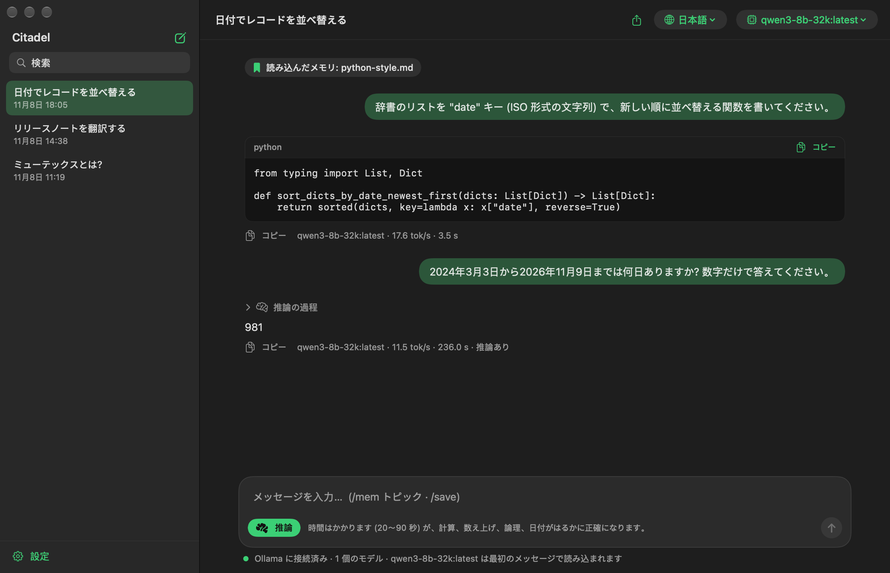
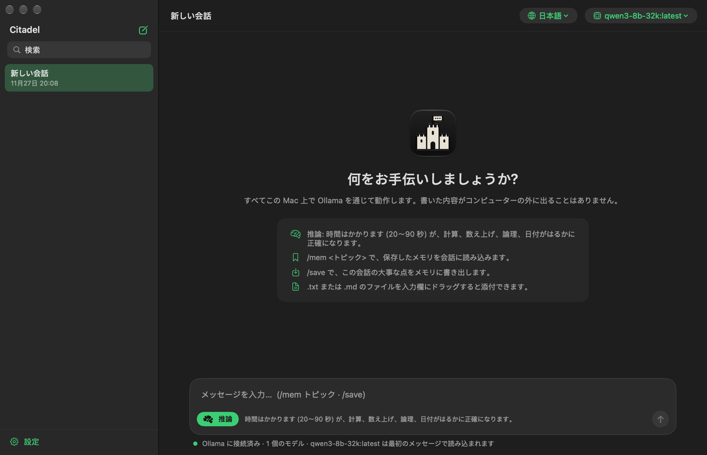
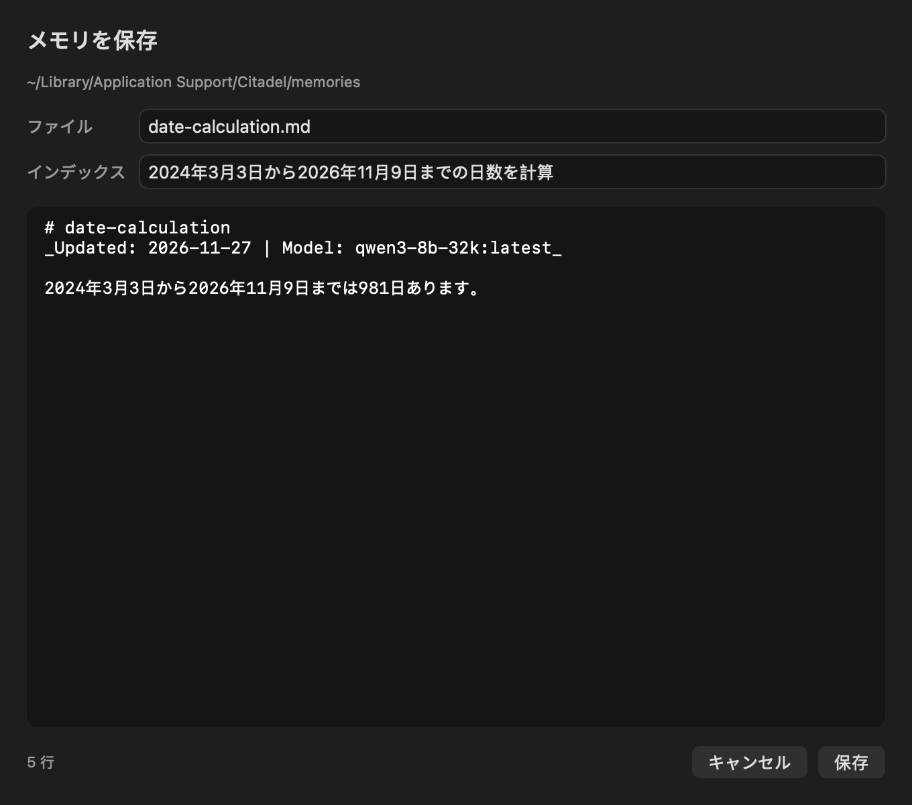
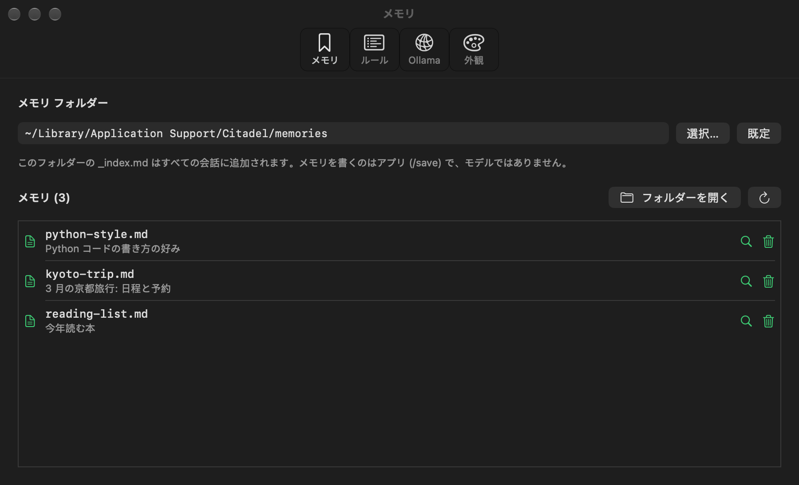
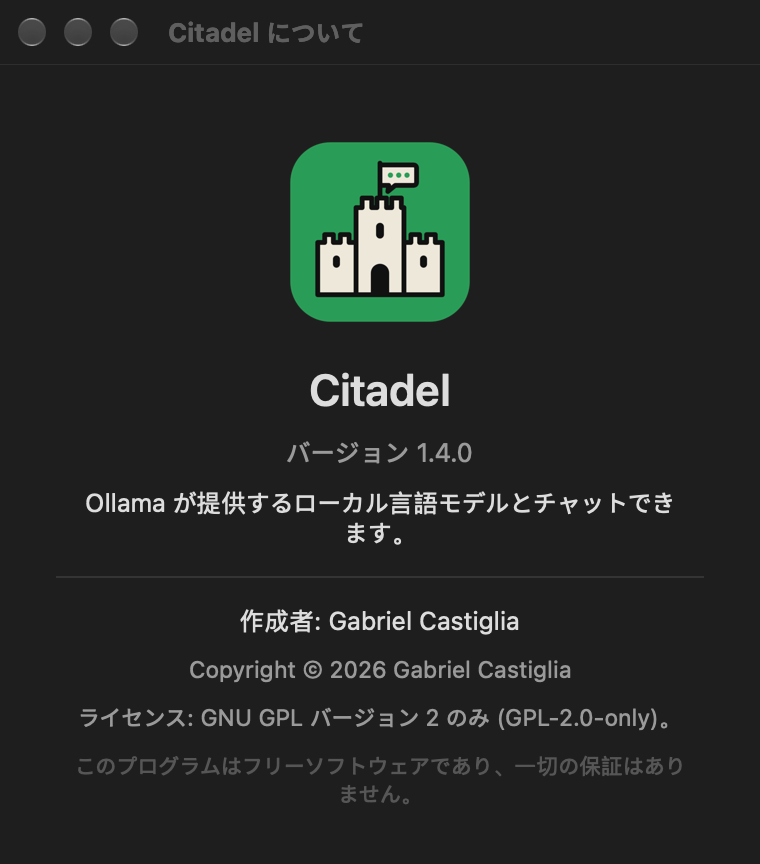

# Citadel

Gabriel Castiglia · 2026年11月27日 · バージョン 1.4.0 · GPL-2.0 ライセンス

[English](README.md) · [Español](README.es.md) · 日本語

リポジトリ: <https://github.com/Gabriel-Castiglia/citadel>

PDF マニュアル: [`docs/Citadel-manual-ja.pdf`](docs/Citadel-manual-ja.pdf)

Citadel は、同じ Mac 上で [Ollama](https://ollama.com) を通じて動く言語モデルと会話する macOS のチャットアプリです。書いた内容がコンピューターの外に出ることはありません: アプリが接続するのは `127.0.0.1:11434` の Ollama だけです。ただし、SSH で自分の別のコンピューターの Ollama を使うことを選んだ場合は別です ([別のコンピューターの Ollama](#別のコンピューターの-ollama) を参照)。Swift と SwiftUI で書かれ、Apple の Command Line Tools だけでビルドでき (Xcode は不要)、表示言語は英語、スペイン語、日本語です。同じ機能を持つ Windows 版は別のリポジトリ <https://github.com/Gabriel-Castiglia/citadel-windows> にあります。

Citadel はチャットウィンドウであり、エージェントではありません。モデルはファイルを開くことも、コマンドを実行することも、Web を閲覧することもできません。モデルが受け取るのは、入力した文章、添付したテキストファイル、毎回のリクエストと一緒に送られるルール、そして頼んだときだけ、保存したメモリの 1 つです。



## 動作環境

- Apple シリコン搭載の macOS 14 Sonoma 以降。
- サービスとして動いている Ollama と、少なくとも 1 つのモデル:

  ```
  brew install ollama
  brew services start ollama
  ollama pull qwen3:8b
  ```

- ソースからビルドする場合: Swift 6 を含む Apple の Command Line Tools (`xcode-select --install`)。PDF マニュアルも作る場合: pandoc (`brew install pandoc`) と Google Chrome。

Citadel は、`qwen3-8b-32k:latest` がインストールされていればそれを選んだ状態で起動し、なければ Ollama が最初に挙げるモデルを選びます。この名前は 32,768 トークンのコンテキストを持つ Qwen3 8B で、次のように作ります:

```
printf 'FROM qwen3:8b\nPARAMETER num_ctx 32768\n' > Modelfile
ollama create qwen3-8b-32k -f Modelfile
```

メモリ 16 GB の Mac では、このモデルは読み込み中に約 7 GB を使い、毎秒 17〜23 トークンを書きます。Ollama は最初のメッセージで読み込み、5 分使わないと解放します。

## インストール

### インストーラパッケージで

[リリースページ](https://github.com/Gabriel-Castiglia/citadel/releases) から `Citadel-<バージョン>.pkg` をダウンロードして開きます。インストーラは Mac の言語に合わせて英語、スペイン語、日本語で表示されます。ようこそのページとライセンスを表示し、起動中の Citadel があれば終了してから `/Applications` に `Citadel.app` をインストールします。古いものの上に新しいパッケージをインストールすると Citadel が更新され、会話、ルール、メモリ、設定は残ります。

パッケージは Apple Developer ID で署名されていないため、初回は macOS が開くのを拒否します (「Apple は検証できませんでした…」)。システム設定 → プライバシーとセキュリティ を開き、`Citadel-<バージョン>.pkg` についてのメッセージまでスクロールして「このまま開く」をクリックし、確認します。これはダウンロードしたパッケージごとに一度だけ必要で、インストールされたアプリは普通に開きます。各リリースの `SHA256SUMS.txt` で、先にダウンロードを確認できます:

```
shasum -a 256 Citadel-1.4.0.pkg
```

### ソースから

```
git clone https://github.com/Gabriel-Castiglia/citadel.git
cd citadel
./scripts/instalar.sh
```

`instalar.sh` はアプリをビルドして署名し、起動中のものがあれば終了してから `/Applications/Citadel.app` にコピーし、そのあと `build/` に残ったコピーを削除します。こうして Spotlight に Citadel が 1 つだけ表示されます。初回は、署名の手順で Mac に専用の証明書が作られます ([署名](#署名) を参照)。`git pull` のあとに同じコマンドを実行すると更新され、会話、ルール、メモリ、設定は残ります。`./scripts/paquete.sh` は代わりに `build/` にインストーラパッケージを作ります。パッケージでインストールしたものは root の所有なので、`instalar.sh` は止まり、先に削除する方法を表示します。

### アンインストール

`/Applications/Citadel.app` をゴミ箱にドラッグします。データは `~/Library/Application Support/Citadel` に、設定は `io.github.gabriel-castiglia.citadel` 環境設定ドメインに残ります。これらも削除するには:

```
rm -rf ~/Library/Application\ Support/Citadel
defaults delete io.github.gabriel-castiglia.citadel
security delete-keychain ~/Library/Keychains/citadel-signing.keychain-db
security delete-generic-password -s citadel-local-signing
```

最後の 2 行は署名用の証明書とそのキーチェーンのパスワードを削除します。これらは Citadel をソースからビルドした Mac にしかありません。残しておけば、次のビルドで同じ証明書が使われます。パッケージでインストールした場合は、`sudo pkgutil --forget io.github.gabriel-castiglia.citadel.pkg` で、macOS が保持するインストールの記録も消せます。

## Citadel の使い方



下のボックスに入力して Enter を押すと送信します。Shift+Enter (または Option+Enter) で改行します。回答は書かれるそばから Markdown として表示されます: 見出し、リスト、表、引用、太字、インラインコード、そして専用のコピーボタンが付いた等幅の枠のコードブロック。各回答の下には、回答全体のコピーボタン、モデル、毎秒のトークン数で表した速度、かかった秒数が表示されます。

### 会話

サイドバーには新しい順に会話が並びます。⌘N か鉛筆のボタンで新しい会話を始め、そのタイトルは最初のメッセージの 1 行目になります。会話を右クリックすると名前の変更や削除ができます。削除は先に確認し、ディスクからファイルを消します。回答を書いている途中の会話を削除すると、その回答も止まります。検索欄 (⌘F) はタイトルで絞り込むほか、保存されたすべての会話の本文も、大文字と小文字、アクセント、改行を区別せずに探します: 「メッセージ内」の下に、一致したものごとに会話、日付、前後の言葉が強調表示され、クリックするとそのメッセージで会話が開き、メッセージが 1 回点滅します。表示する結果は最大 200 件です。サイドバーの日付は表示言語の形式になります。

ヘッダーの共有ボタン、またはサイドバーの会話のメニューから、会話を Markdown に書き出せます: タイトル、日付、モデル、各発言をそれぞれの見出しの下に、コードブロックはそのまま、添付と推論は `<details>` に折りたたんで書き出します。見出しなどの言葉は表示言語になります。「エクスポート後に開く」をオンにすると、macOS が `.md` ファイルに使うアプリでファイルが開きます。

### アップデート

Citadel → アップデートを確認 で GitHub に最新リリースを問い合わせます。1 日 1 回の確認も同じです。新しいものがあれば、質問は 1 回だけです: 今すぐアップデート、新機能を見る、後で。今すぐアップデート を選ぶと、パッケージをダウンロードしてリリースの `SHA256SUMS.txt` と照合し (一致しないファイルは開かずに削除します)、中のアプリが同じ識別子、告知されたバージョン、同じ署名を持つことを確認し、選んだとおりに進行中の回答を待つか止めてから終了します。新しいアプリが古いものと入れ替わり、入力中の文章と開いていた会話のまま開きます。`/Applications/Citadel.app` ではないコピーにはダウンロードページを、別のユーザーがインストールしたものには確認済みのパッケージをインストーラで開きます。確認の途中でもう一度頼むと、確認中であることを知らせます。

### モデル

右上のモデルメニューには、Ollama にインストールされたすべてのモデルが並びます。1 つ選ぶと、次のメッセージはそのモデルに送られます。選んだモデルは保存され、各回答の下にそれを書いたモデルが表示されるので、1 つの会話で複数のモデルを比べられます。ターミナルでモデルをインストールしたあとは、「一覧を更新」で一覧を読み直します:

```
ollama pull gemma3:12b
```

[Ollama のライブラリ](https://ollama.com/library) のどのチャットモデルも使えます。推論できないモデル (Ollama がその機能に「thinking」を挙げていないもの) はメニューに「(推論なし)」付きで表示され、それを選んでいる間は推論ボタンが淡色になり、ツールチップに理由が表示されます。Citadel は一覧を作るときに各モデルの機能を Ollama に問い合わせるので、新しいモデルは現れたらすぐに分類されます。

Ollama は、モデルが別に指定していない限り、各モデルに数千トークンのコンテキストウィンドウを与えます。長い会話や大きな添付には、[動作環境](#動作環境) のように大きなウィンドウを持つ派生モデルを作り、メニューで選びます。ウィンドウが大きいほど多くのメモリが必要です。

### 状態

テキストボックスの下の行には、Ollama が応答しているかとその場所 (この Mac か、SSH 経由の別のコンピューターか)、モデルが読み込まれているか次のメッセージで読み込まれるか、モデルが今していること (読み込み中、推論中、書いている) と経過秒数、直前の回答の速度が表示されます。Ollama が応答しないときは、同じ行に対処方法が表示されます: `brew services start ollama`、または SSH のエラーです。Ollama から読み取れない応答が返ったとき (たとえばポートで別のプログラムが動いているとき) も、そのことをわかりやすく表示します。

### 推論

推論ボタンを押すと、モデルは答える前に考えます。その推論は回答の上の淡色のブロックに入ります。ブロックは折りたたまれたまま、モデルが考えている間は最新の行を表示し、クリックで開きます。推論は時間がかかりますが、計算、文字や単語の数え上げ、論理、日付がはるかに正確になります。推論なしではモデルはすぐに答え、説明、文章作成、翻訳、コードには十分です。推論は推論できるモデルでだけ使えます ([モデル](#モデル) を参照)。

推論がオンのとき、回答は最大 8,000 トークン、オフのときは最大 3,000 トークンまで書けます。これらの値の根拠となった測定は [技術的な注意](#技術的な注意) にあります。

### 停止

回答を書いている間、送信ボタンは停止ボタンになります (⌘. でも同じ)。接続を閉じ、Ollama は生成を止めます。それまでに書かれた分は残り、「停止しました」と表示されます。

### 添付

`.txt` または `.md` ファイルをテキストボックスにドラッグすると、その文章を次のメッセージに添付します。チップにファイル名と長さが表示され、削除するボタンがあります。1 ファイルは最大 2 MB で、それより大きいファイルはメッセージを出して添付しません。文章はそのファイル自身のエンコーディング (バイト順マーク、UTF-8、または Shift_JIS や Windows-1252 など macOS が判別するもの) で読むので、UTF-8 でないファイルも文字化けしません。

### メモリ

メモリは、メモリフォルダーにある短い Markdown ファイルで、そのフォルダーの `_index.md` に 1 メモリ 1 行で載っています:

```
`kyoto-trip.md` — 3 月の京都旅行: 日程と予約
```

インデックスは毎回のリクエストと一緒に送られるので、モデルはどのメモリがあるかを知っています。内容は、読み込むまで送られません:

- `/mem <トピック>` は、インデックスの行かファイル名がトピックと最も多くの言葉を共有するメモリを探し (アクセントと大文字・小文字は区別しません)、会話に加えます。チップに「読み込んだメモリ:」とファイル名が表示されます。一致するものがなければ、Citadel がそう伝えます。
- `/save` は、今の会話からメモリを書くようモデルに頼みます: タイトル、`_Updated: YYYY-MM-DD | Model: <モデル>_` の行、残す価値のある事実を、会話の言語で書きます。プレビューが開き、ファイル名、インデックスの行、本文を編集できます。ファイルがすでにある場合は、置き換えることがプレビューに表示されます。保存すると、ファイルとそのインデックスの行を書き込み、両方をディスクから読み直してから、はじめて会話で確認を表示します。



メモリを書くのはモデルではなく Citadel です。小さなローカルモデルは、何も保存せずに「保存しました」と答えることがよくあるので、モデルには下書きだけをさせ、書き込みと確認はアプリが行います。

### 設定

Citadel → 設定… (⌘,) には 4 つのタブがあります。



| タブ | 内容 |
|---|---|
| メモリ | メモリフォルダー (選択…、または 既定 で `~/Library/Application Support/Citadel/memories` に戻す)、インデックスの行付きのメモリの一覧、フォルダーを開く、各メモリの Finder で表示、そして 削除 (先に確認し、ファイルとそのインデックスの行を消します)。 |
| ルール | 毎回のリクエストの最初に送られるルール。編集できます。保存 (⌘S) で書き込み、元に戻す で変更を破棄し、既定に戻す で元のルールに戻します。設定を開いたまま言語を変えても、保存していない編集は残ります。 |
| Ollama | Ollama が動く場所: この Mac か、SSH 経由の別のコンピューターか ([別のコンピューターの Ollama](#別のコンピューターの-ollama) を参照)。適用してテスト ですぐに接続し、見つかったモデルを一覧表示します。 |
| 外観 | ウィンドウの見た目と 12 色 ([テーマと色](#テーマと色) を参照)。 |

同じ `_index.md` の形式を守る限り、ほかのツールが使っているフォルダーも含めて、どのフォルダーでもメモリフォルダーにできます。

### ルール

毎回のリクエストは、ルールファイル、メモリのインデックス、`/mem` で読み込んだメモリからなるシステムメッセージで始まります。ルールファイルは `~/Library/Application Support/Citadel/rules.md` で、初回の起動時に次のルールで作られます:

1. ユーザーの言語で、聞かれたことに正確に答える。結果だけを求められたら、結果だけを返す。
2. 作り話をしない: 答えがわからない、学習データより後のこと、私的なこと、存在しないかもしれないことについては、1 文でそう言う。
3. 前提を確かめ、誤っていれば最初にそう言う。
4. 正確な形式: JSON のみ、リストのみ、ちょうど N 個と言われたら、そのとおりにする。
5. コード: 関数全体を入れた、フェンス付きの Markdown コードブロック 1 つ。`input()` や呼び出し例は付けない。
6. 翻訳: バッククォートの間の文字列、パス、コマンド、数値、名前はそのままにし、翻訳だけを返す。
7. モデルは Ollama でローカルに動いており、何もコンピューターの外に出ない。

最後のルールがあるのは、どこで動いているかと聞かれたローカルモデルが、知りようがないのにクラウドで動いていると答えがちだからです。

### 言語

最初の起動時、表示言語は Mac の言語がスペイン語か日本語ならその言語、それ以外は英語です。右上のモデルメニューの隣にある地球のボタンが今の言語を表示し、English、Español、日本語 を切り替えます。メニューバーの言語メニュー (英語では Language、スペイン語では Idioma) も同じことをします。変更はすぐに反映され、保存されます。macOS がすべてのアプリに加えるメニュー (編集、表示、ウインドウ、ヘルプ) は、macOS がアプリの起動時に読むため、次の起動から同じ言語になります。表示言語を変えても回答の言語は変わりません: モデルは、書いた言語で答えます。

### テーマと色

設定 → 外観 でウィンドウの見た目を選びます: macOS に合わせる (ほかのアプリと同じくライトかダーク)、ライト、ダーク (既定)。その下の 12 色で、ボタン、選択範囲、Dock のアイコンの城の後ろの光の色が変わります。緑が元の色です。Finder と Launchpad のアイコンは緑のままです。変えるとアプリの署名が壊れるためです。Windows 版も同じ選択肢を持っています。

### 別のコンピューターの Ollama

この Mac には大きすぎるモデルを自分の別のコンピューターで動かし、Citadel から SSH で使えます。Citadel は `/usr/bin/ssh` を、空いているローカルのポートからそのコンピューターのポート 11434 へのトンネル付きで起動し、すべてのリクエストをそこに通し、終了時に閉じます。Ollama のポートがネットワークに開かれることはなく、もう一方のコンピューターは SSH を受け付けるだけで済みます。会話、ルール、メモリはこの Mac に残り、もう一方のコンピューターは、Ollama がいつもそうするように、送られたリクエストを受け取るだけです。

モデルを動かすコンピューターで:

1. [動作環境](#動作環境) のように Ollama とモデルをインストールします。Ollama は既定の `127.0.0.1` で待ち受けるだけで十分です。
2. SSH サーバーをオンにします: Mac では システム設定 → 一般 → 共有 → リモートログイン、Windows では 設定 → システム → オプション機能 → OpenSSH サーバー のあと `sshd` サービスを開始します。
3. この Mac の公開鍵 (`~/.ssh/id_ed25519.pub`。なければ `ssh-keygen -t ed25519` で作ります) を許可します。ユーザーの `~/.ssh/authorized_keys` に次のような行を書くと、その鍵には Ollama のポートの転送だけが許され、それ以外 (シェル、コマンド、ほかのポート) はできません:

   ```
   restrict,port-forwarding,permitopen="127.0.0.1:11434",command="/usr/bin/false" ssh-ed25519 AAAA… name
   ```

この Mac で 設定 → Ollama を開き、「別のコンピューター (SSH 経由)」を選んで接続先 (`ユーザー@ホスト`、または `~/.ssh/config` の `Host` 名) を入力し、適用してテスト をクリックします。結果の行にそこで見つかったモデルが表示され、テキストボックスの下の状態の行には「<ホスト> の Ollama (SSH)」と表示されます。Citadel はパスワードを尋ねません (ssh をバッチモードで実行します)。そのため鍵はパスワードなしで使えるか、SSH エージェントに読み込まれている必要があります。新しいホストへの最初の接続でその鍵が `~/.ssh/known_hosts` に記録され、あとでその鍵が変わると、ほかの SSH クライアントと同じく接続は失敗します。接続が切れたら、Citadel は次のリクエストでもう一度開きます。



### キーボードと VoiceOver

| キー | 操作 |
|---|---|
| Enter | 送信 |
| Shift+Enter、Option+Enter | 改行 |
| ⌘N | 新しい会話 |
| ⌘F | 会話を検索 |
| ⌘. | 回答を停止 |
| ⌘, | 設定 |
| ⌘S | ルールを保存 (ルールタブ) |

アイコンだけのボタン (新しい会話、エクスポート、送信、停止、各メモリの Finder で表示と削除、更新) には、VoiceOver が読み上げる名前が付いています。

## ファイル

| 内容 | 場所 |
|---|---|
| アプリ | `/Applications/Citadel.app` |
| 会話 | `~/Library/Application Support/Citadel/conversations/`。1 会話 1 JSON ファイル |
| ルール | `~/Library/Application Support/Citadel/rules.md` |
| メモリ (既定のフォルダー) | `~/Library/Application Support/Citadel/memories/`。`_index.md` 付き |
| 設定 (言語、モデル、推論、メモリフォルダー、SSH の接続先、ウィンドウの大きさ) | 環境設定ドメイン `io.github.gabriel-castiglia.citadel` |
| 署名用キーチェーン | `~/Library/Keychains/citadel-signing.keychain-db` |

ファイルはバイト順マークなしの UTF-8 で、まず全体を書いてから古いファイルと入れ替えるので、停電で空のファイルが残ることはありません。会話はただの JSON で、Citadel を閉じていれば読んだり、コピーしたり、削除したりできます。

## 署名

`scripts/firma.sh` は「Citadel (local signing)」という名前の証明書でアプリに署名します。初回の実行で `/usr/bin/openssl` を使って作り、専用のキーチェーン `~/Library/Keychains/citadel-signing.keychain-db` に保存し、そのキーチェーンのランダムなパスワードをログインキーチェーンにサービス名 `citadel-local-signing` で保存します。2 回目以降は同じ証明書を使います。

証明書が変わらないことが大切なのは、macOS が権限とキーチェーンへのアクセスをアプリの署名と結び付けるからです。アドホック署名はビルドのたびに変わり、macOS は更新のたびに別のアプリとして扱ってしまいます。この証明書なら、`codesign -d -r- /Applications/Citadel.app` はどのビルドのあとも同じ `certificate leaf` のハッシュを表示します。証明書は Citadel をビルドする Mac ごとに作られ、その Mac から出ることはありません。Apple Developer ID ではないので、Citadel は動かす場所でビルドすることを想定しています。

## ソースからのビルド

| スクリプト | すること |
|---|---|
| `scripts/compilar.sh` | `Sources/*.swift` を `swiftc` で `build/Citadel.app` にコンパイルし、`icono/icono-1024.png` からアイコンファイルを作り、`Info.plist` を書きます。バージョンはここでだけ設定し、Citadel について ウィンドウは `Info.plist` から読みます。 |
| `scripts/firma.sh` | `build/Citadel.app` に署名します ([署名](#署名) を参照)。 |
| `scripts/instalar.sh` | 両方を実行してから `/Applications` にインストールします。 |
| `scripts/paquete.sh` | 両方を実行してから、`instalador/` からインストーラパッケージ `build/Citadel-<バージョン>.pkg` を作ります。 |
| `scripts/manual.sh` | `README.md`、`README.es.md`、`README.ja.md` から `docs/` に PDF マニュアルを作ります。 |
| `icono/render.sh` | ヘッドレスの Chrome で `icono/icono.svg` を `icono/icono-1024.png` に描き出します。 |

アプリにはメンテナンス用のモードが 2 つあります。どちらも `--data-folder <フォルダー>` を受け付け、`~/Library/Application Support/Citadel` 以外のフォルダーを使うので、本物の会話には触れません。

- `Citadel --self-test --memory-folder <空のフォルダー>` は主な機能を Ollama に対して最初から最後まで実行し、確認ごとに PASS か FAIL の行を 1 つ出力します: モデルの一覧、推論なしと推論ありの回答、停止、`/save` (ファイル、インデックスの行、バイト順マークなし)、`/mem`。使用中のメモリフォルダーに対しては実行しません。
- `Citadel --screenshot <ファイル.png>` はメインウィンドウの画像を保存して終了します。`--screenshot-view about`、`settings`、`save` を付けると、代わりにそのウィンドウを写します (`save` は選んでいる会話について、モデルに本物の下書きを頼みます)。`-language es` や `-language ja` を加えると、その言語の表示になります。`docs/images` の画像はこの方法で作りました。

| フォルダー | 内容 |
|---|---|
| `Sources` | アプリ: SwiftUI のビュー、Ollama クライアント、会話、メモリ、設定、セルフテスト。 |
| `scripts` | ビルド、署名、インストール、パッケージ、マニュアル。 |
| `instalador` | パッケージの定義: `Distribution.xml`、起動中のコピーを終了するスクリプト、英語・スペイン語・日本語のようこそと完了のページ。 |
| `icono` | アイコン。SVG と 1024 ピクセルの PNG。 |
| `docs` | PDF マニュアル、画像、マニュアルのスタイルシート。 |

## 技術的な注意

- Command Line Tools の SwiftUI にはマクロを展開するプラグインが含まれていないので、`@State` はコンパイルできません。ビューの状態はすべて、`@Published` プロパティを持つ `ObservableObject` に置いています。
- タイトルバーを隠すと、SwiftUI は `.defaultSize` を無視します。ウィンドウの大きさ、最小サイズ (820 × 540)、macOS がその位置を覚えるための名前は、アプリのデリゲートが設定します。
- 回答は `/api/chat` から 1 行に 1 つの JSON オブジェクトとして届きます。停止はそれを読むタスクをキャンセルし、接続を閉じます。すると Ollama は、そのログ (`srv stop: cancel task`) が示すとおり生成を取り消します。推論を `thinking` フィールドではなく `<think>` タグの間に書くモデルにも対応しています。タグが回答の 2 つの断片にまたがって届いても、本文には混ざりません。
- 数え上げ、計算、論理、日付の難しい質問 15 問を 2 回ずつ聞いたところ、Qwen3 8B は推論なしで 30 回中 9 回、推論ありで 30 回中 26 回正解しました。推論ありの回答時間の中央値は 38 秒、最も遅いもので 172 秒でした。モデルが推論の中でループし、8,000 トークンの上限に達することがあり、毎秒約 9 トークンでは最大 15 分かかります。停止で終わらせられます。
- `/save` は、推論オフ、上限 3,000 トークンで、モデルに JSON (`"format": "json"`) を求めます。そのあと Citadel がファイル名をケバブケースにし、`_Updated` の行を本当の日付とモデルで書き直し、同じファイルの古いインデックスの行を、2 行目を足さずに置き換えます。
- 会話ファイルはフィールドが欠けていても読めるので、ほかのバージョンが書いたファイルも開けます。
- 推論の機能を持たないモデルに `"think": true` のリクエストを送ると、Ollama はエラー (「does not support thinking」) を返します。Citadel は `/api/show` から機能を読み、そうしたモデルには推論ボタンの状態にかかわらず `"think": false` を送ります。
- SSH トンネルは `ssh -N` を `BatchMode=yes`、`ExitOnForwardFailure=yes`、15 秒ごとのキープアライブ付きで実行します。Citadel はローカル側が接続を受け付けるまで待ってから送信します。Citadel が終了ではなく強制終了された場合、次の起動時に残したトンネルを終わらせます。Ollama や SSH のコンピューターに届かないとき、状態の確認は前の確認が終わるまで重ねて送りません。

## クレジット

Citadel はモデルの実行に [Ollama](https://ollama.com) (MIT ライセンス) を使います。モデルはそれぞれのライセンスのもとで別にダウンロードします。Qwen3 は Qwen チームが Apache 2.0 ライセンスで公開しています。

## ライセンス

Copyright (C) 2026 Gabriel Castiglia.

Citadel はフリーソフトウェアです。Free Software Foundation が公開する GNU General Public License バージョン 2 のみ (GPL-2.0-only) の条件のもとで、再配布や改変ができます。一切の保証はありません。全文は [`LICENSE`](LICENSE) にあります。

変更履歴: [`CHANGELOG.md`](CHANGELOG.md)。
