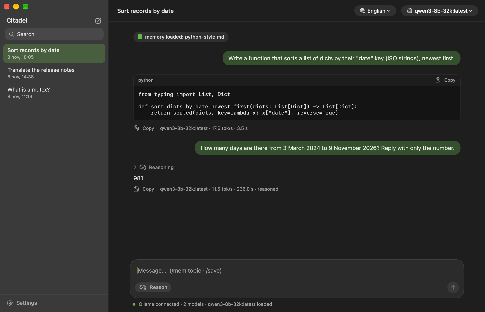
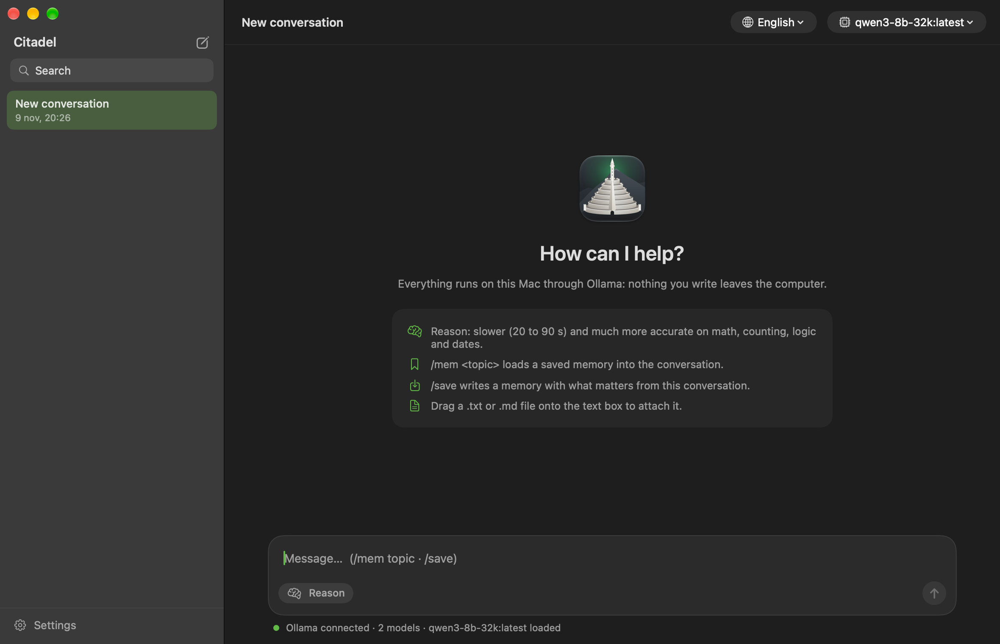
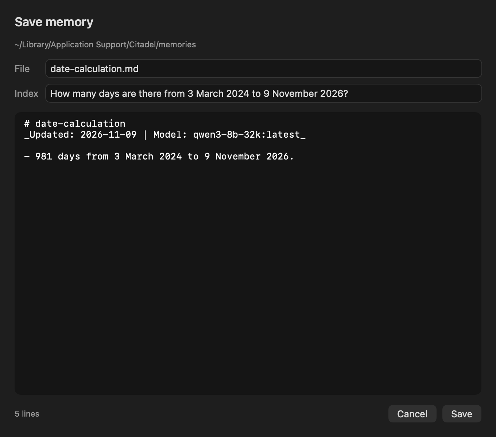
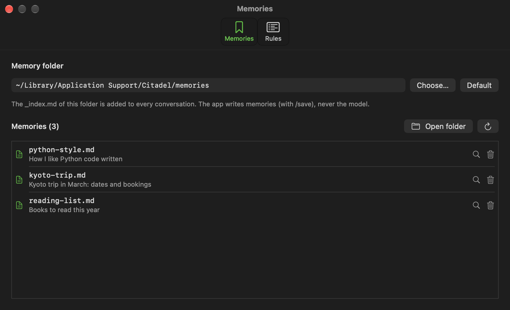
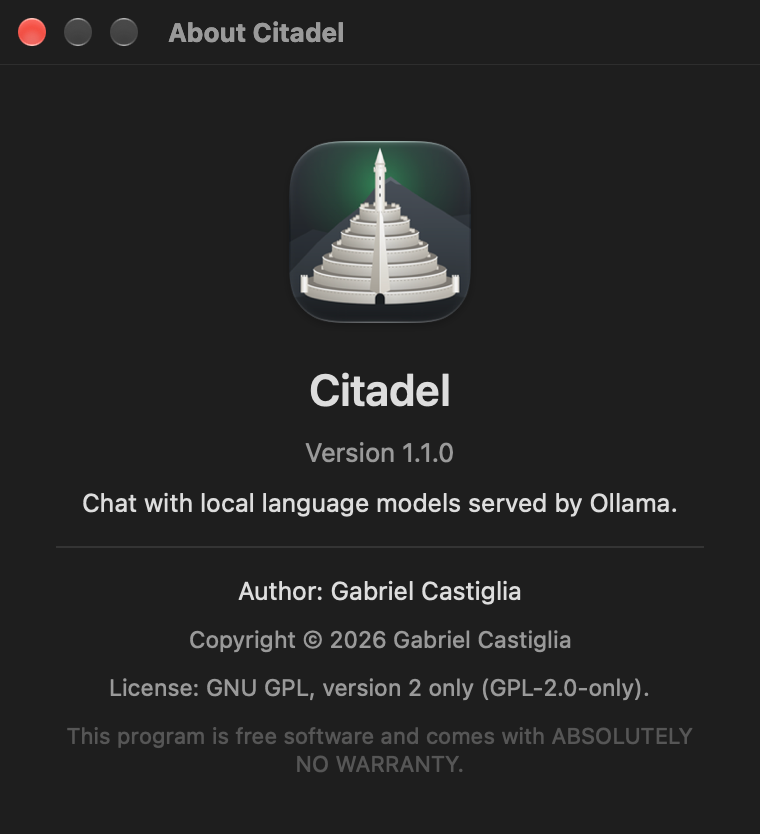

# Citadel

Gabriel Castiglia · November 9, 2026 · version 1.0.1 · GPL-2.0 license

English · [Español](README.es.md)

Repository: <https://github.com/Gabriel-Castiglia/citadel>

PDF manual: [`docs/Citadel-manual-en.pdf`](docs/Citadel-manual-en.pdf)

Citadel is a chat app for macOS that talks to language models running on the same Mac through
[Ollama](https://ollama.com). Nothing you write leaves the computer: the app only connects to Ollama
at `127.0.0.1:11434`. It is written in Swift and SwiftUI, builds with the Apple Command Line Tools
alone (no Xcode), and its interface is in English and Spanish. A Windows version with the same
features lives in its own repository, <https://github.com/Gabriel-Castiglia/citadel-windows>.

Citadel is a chat window, not an agent. The model cannot open files, run commands or browse the web.
What it gets is what you type, the text files you attach, a set of rules sent with every request and,
when you ask for it, one of your saved memories.



## Requirements

- macOS 14 Sonoma or later on Apple silicon.
- Ollama, running as a service, with at least one model:

  ```
  brew install ollama
  brew services start ollama
  ollama pull qwen3:8b
  ```

- To build: the Apple Command Line Tools (`xcode-select --install`), which bring Swift 6. To build the
  PDF manuals as well: pandoc (`brew install pandoc`) and Google Chrome.

Citadel starts with the model `qwen3-8b-32k:latest` selected when it is installed, and otherwise with
the first model Ollama lists. That name is Qwen3 8B with a 32,768-token context, created like this:

```
printf 'FROM qwen3:8b\nPARAMETER num_ctx 32768\n' > Modelfile
ollama create qwen3-8b-32k -f Modelfile
```

On a Mac with 16 GB of memory this model takes about 7 GB while loaded and writes 17 to 23 tokens per
second. Ollama loads it with the first message and unloads it after 5 minutes without use.

## Installation

```
git clone https://github.com/Gabriel-Castiglia/citadel.git
cd citadel
./scripts/instalar.sh
```

`instalar.sh` builds the app, signs it and copies it to `/Applications/Citadel.app`, quitting a running
copy first, and then deletes the copy left in `build/`, so Spotlight lists Citadel once. The first time, the signing step creates a certificate of its own on your Mac (see
[Signing](#signing)). Run the same command to update after a `git pull`; conversations, rules,
memories and settings are kept.

To uninstall, delete `/Applications/Citadel.app`. The data stays in
`~/Library/Application Support/Citadel` and the settings in the `io.github.gabriel-castiglia.citadel`
preferences domain; to remove them too:

```
rm -rf ~/Library/Application\ Support/Citadel
defaults delete io.github.gabriel-castiglia.citadel
security delete-keychain ~/Library/Keychains/citadel-signing.keychain-db
security delete-generic-password -s citadel-local-signing
```

The last two lines remove the signing certificate and its keychain password. Without them, a later
installation reuses the same certificate.

## Using Citadel



Type in the box at the bottom and press Enter to send. Shift+Enter (or Option+Enter) starts a new line.
The answer appears as it is written, rendered as Markdown: headings, lists, tables, quotes, bold, inline
code, and code blocks in a monospaced box with their own Copy button. Under each answer are a Copy
button for the whole answer, the model, its speed in tokens per second and the seconds it took.

### Conversations

The sidebar lists the conversations, newest first. ⌘N or the pencil button starts a new one, and its
title is the first line of the first message. Right-click a conversation to rename it or delete it;
deleting asks first and removes its file from disk. The search field filters by title, ignoring case
and accents.

### Model and status

The model menu at the top right lists the models installed in Ollama, and "Refresh list" reads them
again. The line under the text box says whether Ollama answers, whether the model is loaded or will
load with the next message, what the model is doing (loading, reasoning, writing) with the seconds
elapsed, and the speed of the last answer. When Ollama does not answer, the same line gives the fix:
`brew services start ollama`.

### Reason

The Reason button makes the model think before it answers. Its reasoning goes in a dimmed block above the
answer. The block stays folded, showing the latest line while the model thinks, and opens with a click. Reason is slower
and much more accurate on arithmetic, counting letters or words, logic and dates. Without it, the
model answers at once and is fine for explanations, writing, translation and code.

With Reason on, an answer may write up to 8,000 tokens; with it off, up to 3,000. See
[Technical notes](#technical-notes) for the measurements behind these choices.

### Stop

While an answer is being written, the send button becomes a Stop button (also ⌘.). It closes the
connection and Ollama stops generating; what was written so far stays, marked "Stopped".

### Attachments and translation

Drag a `.txt` or `.md` file onto the text box to attach its text to the next message; a chip shows the
file name and its length, with a button to remove it. The Translate menu fills the box with
"Translate to English:" or "Traduce al español:" followed by the attached text, ready to send. The
rules ask the model to keep code, paths, commands, numbers and names unchanged.

### Memories

A memory is a short Markdown file in the memory folder, listed in that folder's `_index.md` with one
line per memory:

```
`kyoto-trip.md` — Kyoto trip in March: dates and bookings
```

The index goes with every request, so the model knows which memories exist. Their content does not,
until you load one:

- `/mem <topic>` finds the memory whose index line or file name shares the most words with the topic
  (accents and case are ignored), and adds it to the conversation. A chip shows "memory loaded:" and
  the file name. If nothing matches, Citadel says so.
- `/save` asks the model to write a memory from the current conversation: a title, the line
  `_Updated: YYYY-MM-DD | Model: <model>_`, and the facts worth keeping, in the language of the
  conversation. A preview opens where the file name, the index line and the text can be edited. If the
  file already exists, the preview says it will be replaced. Save writes the file and its index line,
  then reads both back from disk, and only then confirms in the conversation.



Citadel writes the memories, not the model. Small local models often reply "saved" without saving
anything, so the model only drafts the text and the app does the writing and the checking.

### Settings

Citadel → Settings… (⌘,) has two tabs.



| Tab | What it holds |
|---|---|
| Memories | The memory folder (Choose…, or Default to go back to `~/Library/Application Support/Citadel/memories`), the list of memories with their index lines, Open folder, Show in Finder for each memory, and Delete, which asks first and removes the file and its index line. |
| Rules | The rules sent at the start of every request, editable. Save (⌘S) writes them; Revert discards the changes; Restore defaults puts back the original rules. |

Any folder can be the memory folder, including one that another tool also uses, as long as it keeps
the same `_index.md` format.

### Rules

Every request starts with a system message made of the rules file, the memory index and any memories
loaded with `/mem`. The rules file is `~/Library/Application Support/Citadel/rules.md`, created on the
first start with these rules:

1. Answer in the user's language and exactly what was asked; when only the result is asked for, give
   only the result.
2. Do not invent: if the answer is unknown, after the training data, private, or about something that
   may not exist, say so in one sentence.
3. Check the premise and say first if it is false.
4. Exact formats: only JSON, only a list or exactly N items means exactly that.
5. Code: one fenced Markdown code block with the complete function, without `input()` or example
   calls.
6. Translation: keep text between backticks, paths, commands, numbers and names unchanged, and reply
   only with the translation.
7. The model runs locally through Ollama and nothing leaves the computer.

The last rule exists because a local model asked where it runs tends to answer that it runs in the
cloud, which it cannot know.

### Language

The interface is in English on the first start. The Language menu (Idioma, when the interface is in
Spanish) switches it at once, and the choice is remembered. The language of the interface does not
change the language of the answers: the model answers in the language you write in.



### Keyboard

| Keys | Action |
|---|---|
| Enter | Send |
| Shift+Enter, Option+Enter | New line |
| ⌘N | New conversation |
| ⌘. | Stop the answer |
| ⌘, | Settings |
| ⌘S | Save the rules (Rules tab) |

## Files

| What | Where |
|---|---|
| App | `/Applications/Citadel.app` |
| Conversations | `~/Library/Application Support/Citadel/conversations/`, one JSON file each |
| Rules | `~/Library/Application Support/Citadel/rules.md` |
| Memories (default folder) | `~/Library/Application Support/Citadel/memories/`, with `_index.md` |
| Settings (language, model, Reason, memory folder, window size) | preferences domain `io.github.gabriel-castiglia.citadel` |
| Signing keychain | `~/Library/Keychains/citadel-signing.keychain-db` |

Files are written in UTF-8 without a byte order mark. Conversations are plain JSON and can be read,
copied or deleted with Citadel closed.

## Signing

`scripts/firma.sh` signs the app with a certificate named "Citadel (local signing)". The first run
creates it with `/usr/bin/openssl`, stores it in a keychain of its own,
`~/Library/Keychains/citadel-signing.keychain-db`, and keeps that keychain's random password in the
login keychain under the service `citadel-local-signing`. Later runs reuse the same certificate.

A stable certificate matters because macOS ties permissions and keychain access to the app's signature.
An ad-hoc signature changes with every build, and macOS would treat each update as a new app. With
this certificate, `codesign -d -r- /Applications/Citadel.app` shows the same `certificate leaf` hash
after every build. The certificate is created on each Mac that builds Citadel and never leaves it; it
is not an Apple Developer ID, so Citadel is meant to be built where it runs.

## Building from source

| Script | What it does |
|---|---|
| `scripts/compilar.sh` | Compiles `Sources/*.swift` with `swiftc` into `build/Citadel.app`, makes the icon file from `icono/icono-1024.png` and writes `Info.plist`. The version is set here and only here; the About window reads it from `Info.plist`. |
| `scripts/firma.sh` | Signs `build/Citadel.app` (see [Signing](#signing)). |
| `scripts/instalar.sh` | Runs both, then installs to `/Applications`. |
| `scripts/manual.sh` | Builds the PDF manuals in `docs/` from `README.md` and `README.es.md`. |
| `icono/render.sh` | Renders `icono/icono.svg` to `icono/icono-1024.png` with headless Chrome. |

The app has two modes for maintenance. Both take `--data-folder <folder>` to use a folder other than
`~/Library/Application Support/Citadel`, so they never touch real conversations.

- `Citadel --self-test --memory-folder <empty folder>` runs the main features end to end against
  Ollama and prints one PASS or FAIL line per check: listing the models, an answer with Reason off
  and with Reason on, Stop, `/save` (file, index line, no byte order mark) and `/mem`. It refuses to
  run against a memory folder in use.
- `Citadel --screenshot <file.png>` saves a picture of the main window and quits; with
  `--screenshot-view about`, `settings` or `save` it pictures that window instead (`save` asks the
  model for a real draft of the selected conversation). Adding `-language es` shows the Spanish
  interface. The images in `docs/images` were made this way.

| Folder | Contents |
|---|---|
| `Sources` | The app: SwiftUI views, the Ollama client, conversations, memories, settings, self-test. |
| `scripts` | Build, signing, installation and manuals. |
| `icono` | The icon, as SVG and as a 1024-pixel PNG. |
| `docs` | PDF manuals, images and the manual stylesheet. |

## Technical notes

- The Command Line Tools ship SwiftUI without the plugin that expands its macros, so `@State` does not
  compile. Every piece of view state lives in an `ObservableObject` with `@Published` properties.
- With a hidden title bar, SwiftUI ignores `.defaultSize`. The app delegate sets the window size,
  its minimum (820 × 540) and the name under which macOS remembers its frame.
- Answers arrive from `/api/chat` as one JSON object per line. Stop cancels the task that reads them,
  which closes the connection; Ollama then cancels the generation, as its log shows
  (`srv stop: cancel task`). Models that write their reasoning between `<think>` tags instead of in
  the `thinking` field are handled too.
- On 15 hard questions of counting, arithmetic, logic and dates, asked twice each, Qwen3 8B answered
  9 of 30 correctly without reasoning and 26 of 30 with it. With reasoning, the median answer took
  38 seconds and the slowest 172. Sometimes the model loops in its reasoning until it reaches the
  8,000-token cap, which at about 9 tokens per second takes up to 15 minutes; Stop ends it.
- `/save` asks the model for JSON (`"format": "json"`) with Reason off and a 3,000-token cap. Citadel
  then makes the file name kebab-case, rewrites the `_Updated` line with the real date and model, and
  replaces the old index line of the same file instead of adding a second one.
- Conversation files tolerate missing fields, so files written by other versions still open.

## Credits

Citadel uses [Ollama](https://ollama.com) (MIT license) to run the models, which are downloaded
separately under their own licenses. Qwen3 is published by the Qwen team under the Apache 2.0 license.

## License

Copyright (C) 2026 Gabriel Castiglia.

Citadel is free software: you can redistribute it and/or modify it under the terms of the GNU General
Public License, version 2 only (GPL-2.0-only), as published by the Free Software Foundation. It is
distributed WITHOUT ANY WARRANTY. See [`LICENSE`](LICENSE) for the full text.

Version history: [`CHANGELOG.md`](CHANGELOG.md).
